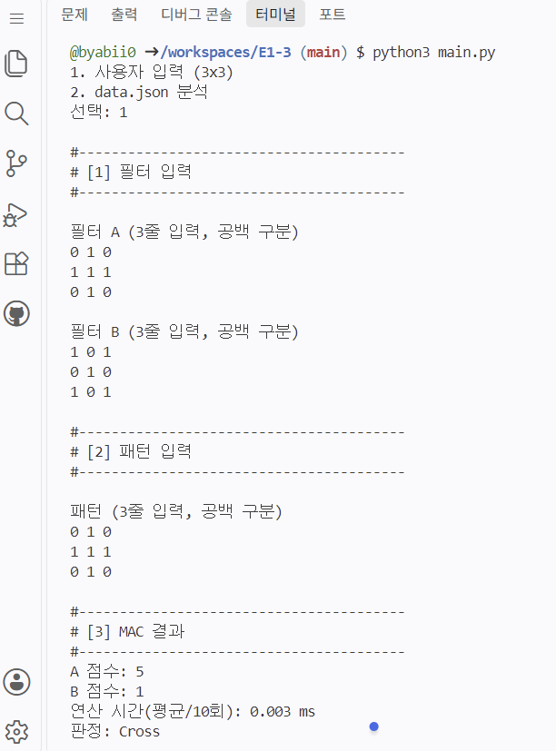
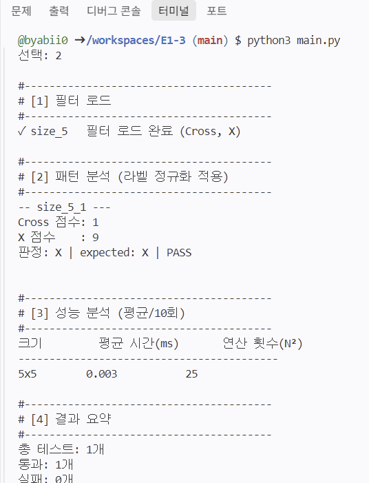

# E1-3
# 프로젝트 개요
📌 한 줄 요약

3×3부터 25×25 크기 패턴의 MAC(Multiply-Accumulate) 연산을 직접 코드로 구현하여, AI 칩(NPU)의 핵심 연산 원리와 데이터 크기별 연산 시간 변화를 체득하는 미션입니다.

🎯 학습 목표

본 미션에서는 2차원 배열 데이터와 필터의 위치별 곱셈 및 총합을 구하는 MAC 연산 원리를 직접 코드로 구현하고, 패턴 크기(3×3~25×25) 변화에 따른 연산량과 실행 시간의 상관관계를 분석합니다. 이를 통해 기존 CPU의 직렬 처리 한계와 대규모 MAC 연산을 효율적으로 동시 처리하는 AI 전용 칩(NPU)의 필요성을 이해하며, Mini NPU 시뮬레이터 개발 과정에서 발생하는 오류를 직접 디버깅하고 해결하는 역량을 기릅니다.

✅ 미션 완료 체크리스트

- MAC(Multiply-Accumulate) 연산이 무엇이고, AI에서 왜 중요한지 설명할 수 있다.
- 입력 패턴과 필터를 곱하고 더해서 유사도(점수)를 계산하는 원리를 설명할 수 있다.
- data.json의 “키 규칙/라벨 규칙”을 해석하고, 프로그램 내부에서 라벨을 표준화(정규화)하는 이유를 설명할 수 있다.
- 부동소수점 오차가 판정에 어떤 영향을 주는지, 그리고 허용오차(epsilon) 기반 비교 정책이 필요한 이유를 설명할 수 있다.
- 크기별 연산 시간을 측정하고, 패턴 크기 증가에 따른 시간 복잡도 O(N²)를 근거와 함께 설명할 수 있다.
- 실패 케이스가 발생했을 때 원인을 “데이터/스키마 문제 vs 로직 문제 vs 수치 비교 문제”로 분리해 진단하고 개선할 수 있다.

# 데이터 구조

# 모드 1 입력 처리(3x3)

모드 1 (사용자 입력 모드)은 사용자가 3×3 크기의 필터 2개와 입력 패턴 1개를 콘솔에서 직접 입력받아 MAC 연산을 수행하고 결과를 판정하는 대화형 모드입니다.

**모드 1의 주요 처리 단계**

1. 필터 및 패턴 입력 받기 (input_matrix)

필터 A, 필터 B, 입력 패턴 순서대로 각 3줄씩(공백 구분) 입력을 요구합니다.

입력 검증 및 재입력 유도: 줄당 숫자가 3개가 아니거나(열 개수 오류), 숫자가 아닌 문자(파싱 오류)가 입력되면 오류 안내 문구를 출력하고 올바른 형식으로 입력할 때까지 재입력을 유도합니다.

2. MAC 연산 수행 (mac_2d)

입력 패턴과 필터 A를 겹쳐 위치별 곱의 합(점수 A)을 계산합니다.
입력 패턴과 필터 B를 겹쳐 위치별 곱의 합(점수 B)을 계산합니다.

3. 연산 시간 측정 (성능 측정)

콘솔 입력 및 출력(I/O) 시간을 제외하고, Pure MAC 연산 구간만 time.perf_counter()로 10회 반복 측정하여 평균 연산 시간(ms)을 산출합니다.

4. Epsilon 기반 판정 (evaluate_decision)

점수 A와 점수 B의 차이를 비교합니다.
두 점수의 차이가 허용 오차(EPSILON = 1e-9)보다 작으면 판정 불가 (|A-B| < 1e-9)를 출력합니다.
점수가 더 높은 필터(A 또는 B)를 최종 판정 결과로 출력합니다.

모드 1 실행 스크린샷

**모드 1에서의 입출력 동작 방식**

터미널에서 모드 1을 선택하면 미리 입력해 둔 필터 A(십자가), 필터 B(X)와 비교할 테스트 대상 패턴을 입력하게 됩니다.

입력 방법: 한 줄에 숫자 3개씩, 총 3줄을 공백으로 구분해 입력합니다.

연산 동작: 시뮬레이터가 이 패턴을 전달받아 필터 A, 필터 B와 각각 MAC 연산(위치별 곱셈 후 누적 합산)을 수행합니다.

결과 판정: 점수가 더 높게 나온 필터 모양(A 또는 B)으로 입력 패턴의 최종 정체를 판정합니다.

# 모드 2 JSON 로드 및 스키마 검증(data.json)

모드 2 (data.json 분석 모드)는 외부 JSON 파일에 저장된 대용량 패턴과 필터 데이터를 불러와 자동으로 스키마 검증, 정규화, MAC 연산, 부동소수점 Epsilon 판정, 성능 측정 및 리포팅을 수행하는 종합 분석 모드입니다.

**모드 2의 주요 처리 단계**

1. JSON 파일 로드 및 필터 정규화 (# [1] 필터 로드)

data.json 파일에서 filters 객체를 읽어옵니다.
size_5, size_13, size_25 등 필터 키에서 크기($N$)를 추출합니다.
필터의 내부 라벨('+', 'cross', 'x' 등)을 normalize_label() 함수를 통해 표준 라벨(Cross, X)로 정규화하여 저장합니다.

2. 패턴 스키마 검증 및 MAC 연산 (# [2] 패턴 분석)

patterns 객체의 각 항목(예: size_13_1)에 대해 아래 검증과 연산을 순차 수행합니다:

1) 크기 추출: 패턴 키 이름에서 $N$값을 파싱합니다.

2) 안전망 검증(Fault-Tolerance):
해당 크기($N$)의 필터가 없거나, 입력 패턴의 행/열 개수가 $N \times N$과 다를 경우 프로그램을 중단하지 않고 해당 케이스만 FAIL로 기록한 뒤 다음 패턴 분석으로 넘어갑니다.

3) MAC 연산: 패턴과 Cross 필터, X 필터를 각각 위치별로 곱하고 더해 점수(score_cross, score_x)를 구합니다.

4) Epsilon 판정 & PASS/FAIL 출력:
$\vert{} \text{score\_cross} - \text{score\_x} \vert{} < 10^{-9}$ 인 경우 UNDECIDED로 분류합니다.
판정 결과와 정규화된 expected 값이 일치하면 PASS, 다르면 FAIL과 그 원인을 콘솔에 출력합니다.

3. 크기별 연산 시간 측정 (# [3] 성능 분석)

각 패턴 크기($N \times N$)별로 파일 읽기나 콘솔 출력(I/O)을 제외한 Pure MAC 연산 구간만 10회 반복 측정합니다.
크기($N \times N$), 평균 연산 시간(ms), 연산 횟수($N^2$)를 표(Table) 형태로 정리하여 출력합니다.

4. 결과 요약 리포트 (# [4] 결과 요약)

전체 테스트 개수, 통과(PASS) 개수, 실패(FAIL) 개수를 종합 집계합니다.
실패 케이스가 존재할 경우 식별자(p_key)와 실패 원인을 한눈에 파악할 수 있도록 리스트로 출력합니다.

모드 2 실행 스크린샷

**모드 2에서의 입출력 동작 방식**

터미널에서 모드 2를 선택하면 data.json 파일의 필터와 패턴을 불러와 정규화하고, MAC 연산으로 구한 판정 결과를 기댓값과 비교하여 PASS/FAIL 여부와 크기별 연산 시간을 자동으로 리포팅합니다.

입력: 사용자가 지정한 data.json 파일에서 다양한 크기의 필터와 패턴 데이터 및 기댓값을 자동으로 읽어와 프로그램 표준 라벨(Cross, X)로 정규화합니다.

연산 동작: 각 입력 패턴과 필터를 $N \times N$ 2중 루프로 위치별 곱셈 후 더하는 MAC 연산을 수행하며, 콘솔 출력을 배제한 pure MAC 연산 구간을 10회 반복 측정하여 평균 연산 시간(ms)을 산출합니다.

결과 판정: 부동소수점 허용 오차(EPSILON = 1e-9) 기반으로 두 필터 간 점수 차이가 작으면 UNDECIDED로 분류하고, 더 높은 점수의 라벨을 기댓값과 비교하여 PASS 또는 FAIL을 확정합니다.

# 라벨 정규화(표준화) 필수 구현

라벨 정규화는 서로 다르게 적힌 데이터 표기(+, cross, x)를 프로그램 내부 표준 이름인 Cross와 X로 통일하는 과정입니다.

변환 규칙:

'+', 'cross' → Cross: 둘 다 똑같은 십자가이므로 Cross로 통일

 'x' → X: 데이터에 소문자 'x'로 적혀 있는 것을 프로그램 표준 이름인 대문자 X로 통일

필요한 이유: 기호(+)와 단어(cross)가 다르면 같은 모양이라도 프로그램이 서로 다른 값으로 인식해 오답(FAIL) 처리하기 때문입니다.

적용: 필터를 불러올 때와 정답(expected)을 비교·출력할 때 모두 이 표준 이름을 기준으로 동작합니다.

# MAC 연산(외부 라이브러리 금지)

MAC(Multiply-Accumulate) 연산은 입력 패턴과 필터라는 두 2차원 배열을 겹쳐 놓고, 같은 위치(행, 열)에 있는 숫자끼리 곱한 뒤 그 결과들을 전부 더하는 핵심 연산입니다.

파이썬의 기본 기능인 2중 for 반복문과 기본 자료형(list, float)만으로 구현했습니다.

# 점수 비교 정책(부동소수점/동점 처리 기준)
    1. 판정 및 PASS/FAIL 출력 규칙
    2. 성능 분석(측정 기준 포함)
    3. 결과 리포트(콘솔 + README 제출)
    4. 실행 흐름

