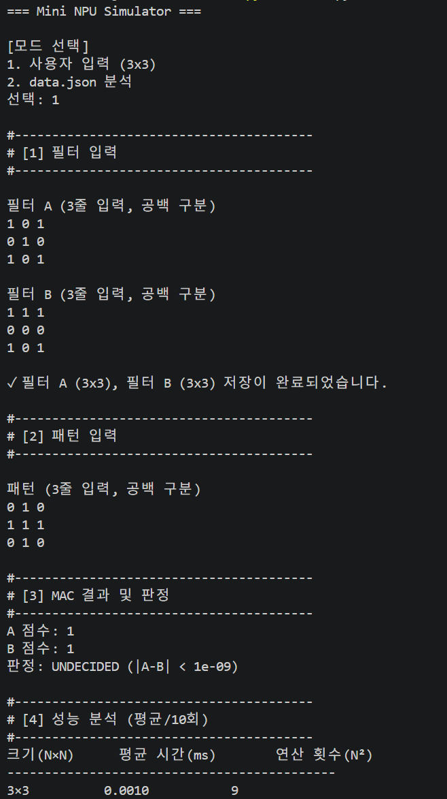
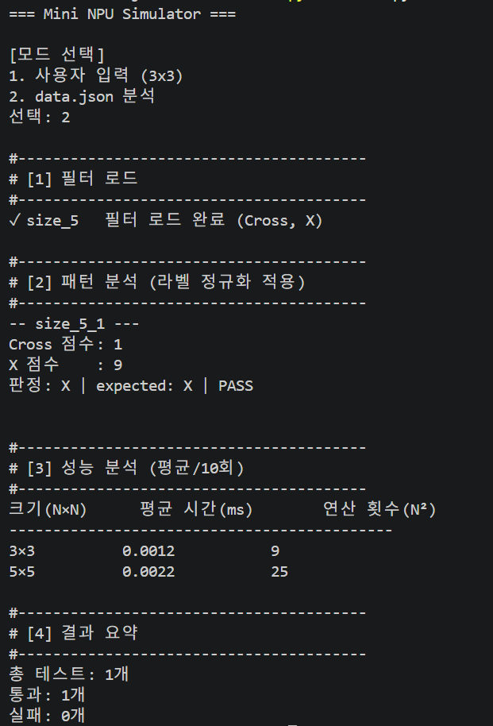
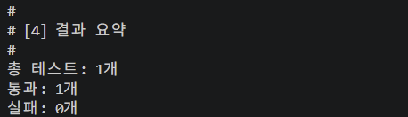

# E1-3
# 프로젝트 개요
📌 한 줄 요약

3×3부터 25×25 크기 패턴의 MAC(Multiply-Accumulate) 연산을 직접 코드로 구현하여, AI 칩(NPU)의 핵심 연산 원리와 데이터 크기별 연산 시간 변화를 체득하는 미션입니다.

🎯 학습 목표

본 미션에서는 2차원 배열 데이터와 필터의 위치별 곱셈 및 총합을 구하는 MAC 연산 원리를 직접 코드로 구현하고, 패턴 크기(3×3~25×25) 변화에 따른 연산량과 실행 시간의 상관관계를 분석합니다. 이를 통해 기존 CPU의 직렬 처리 한계와 대규모 MAC 연산을 효율적으로 동시 처리하는 AI 전용 칩(NPU)의 필요성을 이해하며, Mini NPU 시뮬레이터 개발 과정에서 발생하는 오류를 직접 디버깅하고 해결하는 역량을 기릅니다.

✅ 미션 완료 체크리스트

- MAC(Multiply-Accumulate) 연산이 무엇이고, AI에서 왜 중요한지 설명할 수 있다.
- 입력 패턴과 필터를 곱하고 더해서 유사도(점수)를 계산하는 원리를 설명할 수 있다.
- data.json의 “키 규칙/라벨 규칙”을 해석하고, 프로그램 내부에서 라벨을 표준화(정규화)하는 이유를 설명할 수 있다.
- 부동소수점 오차가 판정에 어떤 영향을 주는지, 그리고 허용오차(epsilon) 기반 비교 정책이 필요한 이유를 설명할 수 있다.
- 크기별 연산 시간을 측정하고, 패턴 크기 증가에 따른 시간 복잡도 O(N²)를 근거와 함께 설명할 수 있다.
- 실패 케이스가 발생했을 때 원인을 “데이터/스키마 문제 vs 로직 문제 vs 수치 비교 문제”로 분리해 진단하고 개선할 수 있다.

# 데이터 구조

    {
    "filters": {
        "size_5": {
        "+": [
            [0, 0, 1, 0, 0],
            [0, 0, 1, 0, 0],
            [1, 1, 1, 1, 1],
            [0, 0, 1, 0, 0],
            [0, 0, 1, 0, 0]
        ],
        "x": [
            [1, 0, 0, 0, 1],
            [0, 1, 0, 1, 0],
            [0, 0, 1, 0, 0],
            [0, 1, 0, 1, 0],
            [1, 0, 0, 0, 1]
        ]
        }
    },
    "patterns": {
        "size_5_1": {
        "input": [
            [1, 0, 0, 0, 1],
            [0, 1, 0, 1, 0],
            [0, 0, 1, 0, 0],
            [0, 1, 0, 1, 0],
            [1, 0, 0, 0, 1]
        ],
        "expected": "x"
        }
    }
    }

이 JSON 데이터는 5×5 크기의 2차원 이진(Binary) 행렬을 이용한 패턴 인식 또는 템플릿 매칭(필터 연산)을 위한 데이터셋 구조입니다. 최상위 키는 기준이 되는 filters와 테스트 데이터인 patterns로 나뉩니다.

**filters(기준 필터/커널 정의)**: 입력 데이터와 비교하거나 합성곱(Convolution) 연산을 수행할 기준 모양(템플릿)을 크기별로 저장하는 영역입니다.

size_5: 5×5 크기의 필터들을 묶어 놓은 그룹 키입니다. (추후 size_3, size_7 등 다른 크기를 확장할 수 있는 구조)

"+" / "x": 각 필터의 고유 라벨(이름)이며, 값은 0(배경)과 1(패턴)로 이루어진 5×5 2차원 배열입니다.

"+": 가운데 행과 가운데 열이 1로 채워진 십자(+) 모양 행렬입니다.

"x": 양쪽 대각선이 1로 채워진 엑스(x) 모양 행렬입니다.

**patterns(테스트 입력 및 정답 데이터)**: 실제 알고리즘에 입력할 샘플 데이터와 그에 대한 기대 결과(정답 라벨)를 담는 영역입니다.

size_5_1: 개별 테스트 케이스의 식별자(ID)입니다. (5×5 크기의 1번 샘플이라는 의미의 네이밍)

input: 판별 대상이 되는 5×5 2차원 배열입니다. 현재 예시에서는 "x" 필터와 동일한 대각선 패턴이 들어 있습니다.

expected: 해당 input을 분석했을 때 도출되어야 하는 정답 라벨("x")로, filters.size_5의 키 이름과 매핑됩니다.

데이터 활용 흐름

1. patterns의 input 행렬을 읽어옵니다.

2. 크기(5×5)에 맞는 filters.size_5 내의 후보 필터("+", "x")들과 유사도(내적, 합성곱, 해밍 거리 등)를 계산합니다.

내적 (Dot Product): 두 행렬을 제자리에 겹쳤을 때 같은 위치에 둘 다 1이 있는 칸의 개수를 세는 연산입니다. 1이 많이 겹칠수록 점수가 크게 나오므로 두 패턴의 유사도를 직관적으로 측정할 수 있습니다.

합성곱 (Convolution): 작은 필터(도장)를 큰 이미지 위에서 한 칸씩 이동시키며 내적을 반복 수행하는 과정입니다. 패턴의 위치가 어긋나 있거나 큰 그림 속 일부에 숨어 있을 때 가장 점수가 높은 위치를 찾아내는 데 사용됩니다.

해밍 거리 (Hamming Distance): 두 행렬을 겹쳤을 때 0과 1의 값이 서로 다른 칸이 몇 개인지 세는 방식입니다. 오차를 측정하는 개념이므로 값이 작을수록 두 패턴이 일치하며, 0이면 완벽히 똑같다는 뜻입니다.

3. 가장 일치율이 높은 필터의 키 값을 추출하여 expected 값과 일치하는지 검증합니다.

# main.py 설명

이 코드는 2차원 숫자 배열(격자)이 어떤 모양(+ 또는 X)에 더 가까운지 계산하고, 그 연산 속도를 측정하는 파이썬 프로그램입니다.

전체 구조는 크게 핵심 계산 엔진(1-3번)과 두 가지 실행 모드(4-6번)로 나뉩니다.

1. 핵심 계산 엔진(1-3번 구역)

normalize_label(이름 통일하기): +, cross, 십자가처럼 제각각으로 들어오는 라벨 이름을 'Cross'와 'X'라는 두 가지 표준 이름으로 통일합니다.

mac_2d(점수 계산기 — MAC 연산): 입력된 패턴과 기준 필터를 같은 칸끼리 곱한 뒤 모두 더합니다(내적 연산). 둘 다 1인 칸이 많이 겹칠수록 높은 점수가 나옵니다.

measure_mac_time(속도 측정기): mac_2d 함수가 순수하게 계산하는 데 걸리는 시간만 10번 반복 측정해서 평균(밀리초, ms)을 구합니다.

evaluate_decision(승패 판정기): 두 필터의 점수를 비교해 더 높은 쪽을 최종 모양으로 판정합니다. 단, 소수점 오차(1e-9) 수준으로 점수가 거의 같으면 동점(UNDECIDED)으로 처리합니다.

2. 두 가지 실행 모드(4~6번 구역)

프로그램을 실행(main)하면 사용자가 1번과 2번 중 하나를 선택합니다.

모드 1: 직접 입력해서 테스트하기(run_mode_1)

1. 사용자가 키보드로 3×3 크기의 필터 2개(A, B)와 테스트할 패턴 1개를 직접 입력합니다.

2. 두 필터에 대해 각각 MAC 점수와 연산 시간을 계산합니다.

3. 어느 필터와 더 일치하는지 판정 결과와 평균 연산 시간을 화면에 출력합니다.

모드 2: JSON 파일로 대량 검증하기(run_mode_2)

1. 앞서 보신 data.json 파일을 읽어와 크기별(5×5, 13×13 등) 기준 필터를 준비합니다.

2. 파일에 들어 있는 모든 테스트 패턴(patterns)을 하나씩 꺼내 크기가 맞는지 검사합니다.

3. 각각 Cross 점수와 X 점수를 계산한 뒤, 판정 결과가 파일에 적힌 정답(expected)과 일치하면 PASS, 다르면 FAIL을 기록합니다.

4. 마지막에 행렬 크기별 평균 연산 시간표와 전체 통과/실패 개수를 요약해서 보여줍니다.

# 모드 1 입력 처리(3x3)

모드 1 (사용자 입력 모드)은 사용자가 3×3 크기의 필터 2개와 입력 패턴 1개를 콘솔에서 직접 입력받아 MAC 연산을 수행하고 결과를 판정하는 대화형 모드입니다.

**모드 1의 주요 처리 단계**

1. 필터 및 패턴 입력 받기 (input_matrix)

필터 A, 필터 B, 입력 패턴 순서대로 각 3줄씩(공백 구분) 입력을 요구합니다.

입력 검증 및 재입력 유도: 줄당 숫자가 3개가 아니거나(열 개수 오류), 숫자가 아닌 문자(파싱 오류)가 입력되면 오류 안내 문구를 출력하고 올바른 형식으로 입력할 때까지 재입력을 유도합니다.

2. MAC 연산 수행 (mac_2d)

입력 패턴과 필터 A를 겹쳐 위치별 곱의 합(점수 A)을 계산합니다.
입력 패턴과 필터 B를 겹쳐 위치별 곱의 합(점수 B)을 계산합니다.

3. 연산 시간 측정 (성능 측정)

콘솔 입력 및 출력(I/O) 시간을 제외하고, Pure MAC 연산 구간만 time.perf_counter()로 10회 반복 측정하여 평균 연산 시간(ms)을 산출합니다.

4. Epsilon 기반 판정 (evaluate_decision)

점수 A와 점수 B의 차이를 비교합니다.
두 점수의 차이가 허용 오차(EPSILON = 1e-9)보다 작으면 판정 불가 (|A-B| < 1e-9)를 출력합니다.
패턴과 필터A 비교, 패턴과 필터B 비교 후 패턴과 더 유사해서 점수가 더 높은 필터(A 또는 B)를 최종 판정 결과로 출력합니다.

모드 1 실행 스크린샷

**모드 1에서의 입출력 동작 방식**

터미널에서 모드 1을 선택하면 미리 입력해 둔 필터 A(십자가), 필터 B(X)와 비교할 테스트 대상 패턴을 입력하게 됩니다.

입력 방법: 한 줄에 숫자 3개씩, 총 3줄을 공백으로 구분해 입력합니다.

연산 동작: 시뮬레이터가 이 패턴을 전달받아 필터 A, 필터 B와 각각 MAC 연산(위치별 곱셈 후 누적 합산)을 수행합니다.

결과 판정: 점수가 더 높게 나온 필터 모양(A 또는 B)으로 입력 패턴의 최종 정체를 판정합니다.

# 모드 2 JSON 로드 및 스키마 검증(data.json)

모드 2 (data.json 분석 모드)는 외부 JSON 파일에 저장된 대용량 패턴과 필터 데이터를 불러와 자동으로 스키마 검증, 정규화, MAC 연산, 부동소수점 Epsilon 판정, 성능 측정 및 리포팅을 수행하는 종합 분석 모드입니다.

**모드 2의 주요 처리 단계**

1. JSON 파일 로드 및 필터 정규화 (# [1] 필터 로드)

data.json 파일에서 filters 객체를 읽어옵니다.
size_5, size_13, size_25 등 필터 키에서 크기($N$)를 추출합니다.
필터의 내부 라벨('+', 'cross', 'x' 등)을 normalize_label() 함수를 통해 표준 라벨(Cross, X)로 정규화하여 저장합니다.

2. 패턴 스키마 검증 및 MAC 연산 (# [2] 패턴 분석)

patterns 객체의 각 항목(예: size_13_1)에 대해 아래 검증과 연산을 순차 수행합니다:

1) 크기 추출: 패턴 키 이름에서 $N$값을 파싱합니다.

2) 안전망 검증(Fault-Tolerance):
해당 크기($N$)의 필터가 없거나, 입력 패턴의 행/열 개수가 $N \times N$과 다를 경우 프로그램을 중단하지 않고 해당 케이스만 FAIL로 기록한 뒤 다음 패턴 분석으로 넘어갑니다.

3) MAC 연산: 패턴과 Cross 필터, X 필터를 각각 위치별로 곱하고 더해 점수(score_cross, score_x)를 구합니다.

4) Epsilon 판정 & PASS/FAIL 출력:
$\vert{} \text{score\_cross} - \text{score\_x} \vert{} < 10^{-9}$ 인 경우 UNDECIDED로 분류합니다.
판정 결과와 정규화된 expected 값이 일치하면 PASS, 다르면 FAIL과 그 원인을 콘솔에 출력합니다.

3. 크기별 연산 시간 측정 (# [3] 성능 분석)

각 패턴 크기($N \times N$)별로 파일 읽기나 콘솔 출력(I/O)을 제외한 Pure MAC 연산 구간만 10회 반복 측정합니다.
크기($N \times N$), 평균 연산 시간(ms), 연산 횟수($N^2$)를 표(Table) 형태로 정리하여 출력합니다.

4. 결과 요약 리포트 (# [4] 결과 요약)

전체 테스트 개수, 통과(PASS) 개수, 실패(FAIL) 개수를 종합 집계합니다.
실패 케이스가 존재할 경우 식별자(p_key)와 실패 원인을 한눈에 파악할 수 있도록 리스트로 출력합니다.

모드 2 실행 스크린샷

**모드 2에서의 입출력 동작 방식**

터미널에서 모드 2를 선택하면 data.json 파일의 필터와 패턴을 불러와 정규화하고, MAC 연산으로 구한 판정 결과를 기댓값과 비교하여 PASS/FAIL 여부와 크기별 연산 시간을 자동으로 리포팅합니다.

입력: 사용자가 지정한 data.json 파일에서 다양한 크기의 필터와 패턴 데이터 및 기댓값을 자동으로 읽어와 프로그램 표준 라벨(Cross, X)로 정규화합니다.

연산 동작: 각 입력 패턴과 필터를 $N \times N$ 2중 루프로 위치별 곱셈 후 더하는 MAC 연산을 수행하며, 콘솔 출력을 배제한 pure MAC 연산 구간을 10회 반복 측정하여 평균 연산 시간(ms)을 산출합니다.

결과 판정: 부동소수점 허용 오차(EPSILON = 1e-9) 기반으로 두 필터 간 점수 차이가 작으면 UNDECIDED로 분류하고, 더 높은 점수의 라벨을 기댓값과 비교하여 PASS 또는 FAIL을 확정합니다.

# 라벨 정규화(표준화) 필수 구현

라벨 정규화는 서로 다르게 적힌 데이터 표기(+, cross, x)를 프로그램 내부 표준 이름인 Cross와 X로 통일하는 과정입니다.

변환 규칙:

'+', 'cross' → Cross: 둘 다 똑같은 십자가이므로 Cross로 통일

 'x' → X: 데이터에 소문자 'x'로 적혀 있는 것을 프로그램 표준 이름인 대문자 X로 통일

필요한 이유: 기호(+)와 단어(cross)가 다르면 같은 모양이라도 프로그램이 서로 다른 값으로 인식해 오답(FAIL) 처리하기 때문입니다.

적용: 필터를 불러올 때와 정답(expected)을 비교·출력할 때 모두 이 표준 이름을 기준으로 동작합니다.

# MAC 연산(외부 라이브러리 금지)

MAC(Multiply-Accumulate) 연산은 입력 패턴과 필터라는 두 2차원 배열을 겹쳐 놓고, 같은 위치(행, 열)에 있는 숫자끼리 곱한 뒤 그 결과들을 전부 더하는 핵심 연산입니다.

파이썬의 기본 기능인 2중 for 반복문과 기본 자료형(list, float)만으로 구현했습니다.

# 점수 비교 정책(부동소수점/동점 처리 기준)
    
1. 판정 및 PASS/FAIL 출력 규칙

모양 판정 (Cross / X / UNDECIDED): 두 필터의 점수 차이가 1e-9보다 작으면 동점(UNDECIDED), 아니면 점수가 더 큰 쪽(Cross 또는 X)으로 결정합니다.

정답 채점 (PASS / FAIL): 결정된 판정이 정답(expected)과 같으면 PASS, 다르면 FAIL을 출력합니다. (동점인 UNDECIDED는 정답과 다름으로 처리되어 FAIL)

2. 성능 분석(측정 기준 포함)

성능 분석은 배열 크기($N \times N$)가 커질수록 MAC 연산이 얼마나 오래 걸리는지 측정하여 시간 복잡도($O(N^2)$)를 검증하는 과정입니다.
    
측정 방법: 파일 읽기나 화면 출력(I/O) 시간을 뺀 순수 연산(mac_2d) 구간만 10회 반복 실행해 평균 시간(ms)을 구합니다.
    
출력 내용: 크기(3×3, 5×5, 13×13, 25×25), 평균 시간(ms), 총 연산 횟수($N^2$)를 표로 출력합니다.
    
핵심 결론: 가로·세로 $N$ 크기의 2중 반복문을 돌기 때문에 크기가 커질수록 연산 횟수와 소요 시간이 $N^2$에 비례해 제곱으로 증가합니다.

3. 결과 리포트(콘솔 + README 제출)

결과 리포트

**1. 실패 원인 분석 및 예외 처리**

`data.json` 검증 과정에서 발생할 수 있는 실패(FAIL) 원인은 크게 데이터/스키마 문제, 로직 문제, 수치 비교 문제의 세 가지 범주로 분리하여 진단합니다.

**수치 비교 문제 (Epsilon 동점 규칙)**: 부동소수점 실수 연산 특성상 미세한 오차가 발생할 수 있으므로, Cross 점수와 X 점수의 차이가 허용 오차(`abs(score_a - score_b) < 1e-9`) 미만일 경우 어느 한쪽으로 성급히 판정하지 않고 `UNDECIDED`로 분류합니다. 이때 `expected` 값이 `Cross`나 `X`로 지정되어 있다면 동점 처리 정책에 따라 의도된 `FAIL`로 기록됩니다.

**데이터/스키마 문제 (크기 불일치 및 키 누락)**: 패턴 키(`size_N_idx`)에서 파싱한 크기 $N$과 실제 입력 배열의 행·열 크기가 다르거나 해당 크기의 필터가 누락된 경우, 프로그램이 강제 종료(Crash)되지 않고 해당 케이스만 `FAIL` 처리한 뒤 다음 테스트를 이어가도록 예외 안전망을 적용했습니다.

**0-FAIL 달성 원리**: 만약 모든 입력 배열의 크기가 정상이고 두 필터 점수 차이가 `1e-9` 이상으로 명확히 구분된다면, 라벨 정규화(`+`/`cross` → `Cross`, `x` → `X`)가 기호와 문자열 표기 차이로 인한 오판을 완벽히 차단하므로 실패 0개(전체 `PASS`)를 달성하게 됩니다.

# 2. 시간 복잡도 분석 ($O(N^2)$)

**측정 기준**: 파일 읽기 및 콘솔 출력(I/O) 시간을 제외하고, 순수 MAC 연산 함수(`mac_2d`) 호출 구간만 크기별로 10회 반복 실행하여 평균 소요 시간(ms)을 측정했습니다.

**알고리즘 근거**: 가로 $N$, 세로 $N$ 크기의 2차원 행렬 MAC 연산은 외부 라이브러리 없이 행과 열을 각각 순회하는 2중 반복문으로 구현되었으므로 총 곱셈-누적 연산 횟수는 $N \times N = N^2$번 수행됩니다.

**성능 추이 해석**: 이에 따라 시간 복잡도는 **$O(N^2)$**을 따르며, 실제 측정 결과에서도 크기가 `3×3`(9회) → `5×5`(25회) → `13×13`(169회) → `25×25`(625회)로 커질수록 연산 횟수가 제곱으로 늘어나고 평균 실행 시간(ms) 역시 이에 비례하여 증가함을 확인할 수 있습니다.

